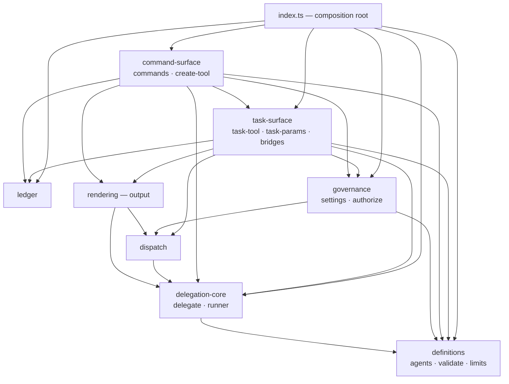

# Architecture

## Topology

One entry point composes eight internal modules. Layers run downward: the
surfaces call orchestration and execution, execution sits on definitions, and
nothing in the lower layers ever reaches up for UI, rendering, or settings.

| Module | Files | Role |
|---|---|---|
| `definitions` | `agents.ts`, `validate.ts`, `limits.ts` | Discover, parse, validate, and write definition files |
| `governance` | `settings.ts`, `authorize.ts` | The `subagents` settings policy and project-agent consent |
| `delegation-core` | `delegate.ts`, `runner.ts` | Run one delegation in a nested isolated session; shape its result |
| `dispatch` | `dispatch.ts` | Fan-out and chain execution over several delegations |
| `rendering` | `output.ts` | Render text for an audience and a mode; pick the output channel |
| `task-surface` | `task-tool.ts`, `task-params.ts`, `bridges.ts` | The model-facing `task` tool: contract, shapes, widget, bridging |
| `command-surface` | `commands.ts`, `create-tool.ts` | The `/subagents` family and the `create_subagent` tool |
| `ledger` | `ledger.ts` | Fold session-log entries into per-agent cost/outcome stats |

Three edges are type-only and worth naming, because they carry design meaning
rather than runtime coupling: `governance → dispatch` (consent takes the
dispatch batch shape, so one confirmation flow covers single, fan-out, and
chain entries uniformly), `rendering → dispatch` / `rendering →
delegation-core` (outcome types only — rendering never decides what runs), and
the internal `runner → delegate` type edge (the nested-session persistence
callback). Everything else in the diagram is a runtime import.

## Composition root and lifecycle

`index.ts` owns wiring and session lifecycle; no module below it sees the Pi
extension API except through the parameters it is handed.

- It registers `create_subagent`, the `task` tool, and `/subagents`.
- The `task` tool's description is rebuilt from the current definition
  inventory and the tool is re-registered only when that description's
  signature changes — the description *is* the tool's identity, so a definition
  added mid-session becomes delegable without a reload.
- `session_start` replaces the in-memory ledger with a fold of the session log
  (the fold replaces state, never adds to it — which is what makes
  `/subagents stats` survive a resume on an empty or replayed log alike),
  clears remembered consent answers, and refreshes the tool.
- `before_agent_start` refreshes the tool again, since definitions may have
  changed between turns.
- Appending `pi-neo-subagents/run` records and `pi-neo-subagents/reset`
  tombstones is the entry point's job (`recordRun`, `resetLedger`); the
  `ledger` module owns only the fold and the rendered stats. See `ledger`.

## Cross-cutting invariants

- **Isolation contract** (executed by `delegation-core`): a nested session
  receives only the task text and the definition, plus the project's context
  files from the working directory — never host history, prompt templates,
  themes, discovered extensions, or Pi's docs. Skills are the one opt-in
  exception: a definition's `skills` field (a name whitelist, or `all`) is
  the only way skill access crosses, and ad-hoc entries never receive it.
  `task` and `create_subagent` never cross into a nested session; recursion
  exists only through a definition's `allowSubagents` opt-in under the
  `maxDepth` limit, and ad-hoc entries never receive `task` at all. See
  `goal` (Principles) and `delegation-core`.
- **Outcome taxonomy**: `ok | budget-stop | failed | skipped`. A budget stop
  is not a failure — it carries the partial reply and names the budget that
  tripped (`isError` stays false); `skipped` exists only for chain steps that
  never ran. Every surface that reports outcomes, and the ledger that counts
  them, must preserve this distinction.
- **Store policy**: the session log is the only durable store. Records are raw
  (agent, status, turns, model, depth, duration, usage, child session id) so
  future statistics need a new fold, not a new store; no task text is ever
  recorded; and a delegation's persistence follows the host's own — an
  in-memory host session writes nothing.
- **Depth semantics**: a top-level delegation is depth 1 (the host is 0).
  `maxDepth` bounds the tree, and `depth` is reported in results and in the
  ledger.
- **Single test seam**: all hermetic tests drive a full in-memory session
  through the SDK with a scripted model and assert only at the session
  boundary (`test/harness.ts`); the live-model smoke suite is env-gated and
  excluded from `npm test`, so a green default run never implies live
  coverage. See `goal` (Principles).

Contracts that belong to one module — strict-vs-lenient validation, consent
rules, the result contract's limits, dispatch ordering, channel routing, the
fold's schema — live in that module's spec, not here.
